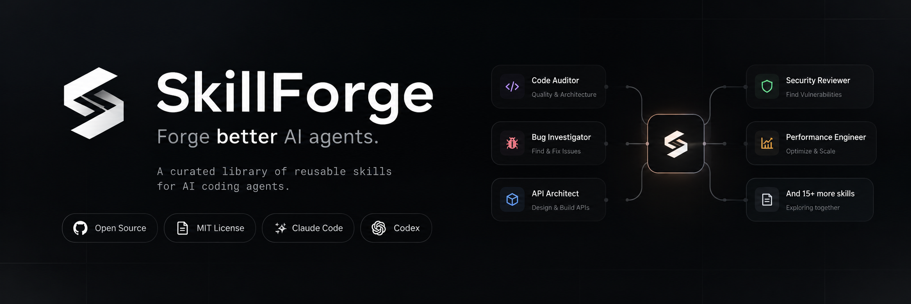

# SkillForge

SkillForge is an open-source library and local CLI for reusable AI coding agent
skills. Each skill supplies a focused engineering workflow through a canonical
`SKILL.md`, with supporting references loaded when needed.

The CLI and workspace packages use the `agentskills` name.

The initial release targets local Claude Code and OpenAI Codex skill discovery.
It provides a TypeScript foundation for discovery, validation, and installation;
there is no hosted registry or published npm package yet.

## Features

- Eighteen portable skills: fourteen engineering skills covering auditing,
  debugging, API design, UI architecture, React, Next.js, Python, databases,
  performance, security, testing, DevOps, AI agents, and documentation, plus four
  meta skills for creating, evaluating, reviewing, and optimizing skills. Each has
  inputs, workflows, constraints, verification criteria, and worked examples.
- Eight specialized agents defined in portable manifests and generated as Claude
  Code subagents or Codex custom agents, with tool allowlists where the platform
  supports them and explicit reporting where it does not.
- A local catalog with `list` and `info` commands.
- Evaluation suites with an `eval` command that runs deterministic static checks
  and grades recorded agent output; it never runs a model or executes fixtures.
- YAML and metadata validation, duplicate detection, local reference and Markdown
  heading checks, and separate errors and warnings.
- Project and user installation adapters for Claude Code and Codex.
- Explicit overwrite authorization, staged copies, rollback on handled publish
  failures, per-skill installer locks, and defensive path checks.
- Unit, integration, and compiled CLI tests, plus a CI matrix for three operating
  systems and Node.js 22/24. CI results require a GitHub run; see
  [compatibility](docs/compatibility.md) for the verification boundary.

## Requirements and installation

Use Node.js **24 LTS** (recommended) or **22.14+ LTS**, and pnpm **10.20.0**.
See the [Node.js release schedule](https://nodejs.org/en/about/previous-releases).
Install pnpm through your usual package manager or, with Corepack installed:

```sh
corepack enable
corepack prepare pnpm@10.20.0 --activate
```

Clone the repository and build the local CLI:

```sh
git clone https://github.com/VitorFalcochio/SkillForge.git
cd SkillForge
pnpm install --frozen-lockfile
pnpm build
pnpm agentskills --help
```

Dependency lifecycle scripts are disabled in the repository configuration. No
skill script is executed by any install command. Packages are private workspace
packages; `npx agentskills` is not a supported installation method for this release.

## Quick start

```sh
pnpm agentskills list
pnpm agentskills info bug-investigator
pnpm agentskills validate skills --strict
pnpm agentskills eval skill-reviewer
pnpm agentskills install code-auditor --agent claude
pnpm agentskills install bug-investigator --agent codex --scope user
pnpm agentskills agents list
pnpm agentskills agents install code-reviewer --platform claude --with-skills
```

Project scope is the default and uses the current working directory. To install
into a different existing project, pass `--project "/path/to/project"`. In
PowerShell, a quoted Windows path such as `"E:\Projects\my app"` works too.
User scope uses the operating system's home directory and ignores `--project`.

| Agent       | Project destination               | User destination               |
| ----------- | --------------------------------- | ------------------------------ |
| Claude Code | `<project>/.claude/skills/<name>` | `<home>/.claude/skills/<name>` |
| Codex       | `<project>/.agents/skills/<name>` | `<home>/.agents/skills/<name>` |

These mappings follow [Claude Code documentation](https://code.claude.com/docs/en/skills)
and [OpenAI documentation](https://learn.chatgpt.com/docs/build-skills), checked
on October 15, 2026. Local installation tests do not prove runtime discovery or
workflow quality in either agent. See [compatibility](docs/compatibility.md).

An existing skill is preserved unless you accept the interactive prompt or pass
`--force`. Noninteractive installs refuse replacement without `--force`.
Replacement removes the whole previous skill tree, including personal additions;
back up any edits you want to keep.

The CLI package declares an executable named `agentskills`. For optional global
use from a source checkout, after configuring pnpm's global binary directory:

```sh
pnpm --dir packages/cli link --global
agentskills list
```

Keep the checkout and built files in place when using a global link. The
`pnpm agentskills` form requires no global setup. More examples and troubleshooting
are in [getting started](docs/getting-started.md).

## Skill catalog

Engineering skills live in `skills/development/`:

| Skill                                                                        | Purpose                                                                           |
| ---------------------------------------------------------------------------- | --------------------------------------------------------------------------------- |
| [code-auditor](skills/development/code-auditor/SKILL.md)                     | Prioritize evidenced correctness, architecture, and maintainability findings      |
| [bug-investigator](skills/development/bug-investigator/SKILL.md)             | Reproduce failures, distinguish hypotheses, and verify root-cause fixes           |
| [api-architect](skills/development/api-architect/SKILL.md)                   | Define contracts, errors, ownership, retries, and compatible evolution            |
| [ui-architect](skills/development/ui-architect/SKILL.md)                     | Design, review, and modernize interfaces within an existing design language       |
| [react-engineer](skills/development/react-engineer/SKILL.md)                 | Build and test typed React components with deliberate state and accessible markup |
| [python-engineer](skills/development/python-engineer/SKILL.md)               | Write typed, tested, packaged Python using the project's own toolchain            |
| [database-architect](skills/development/database-architect/SKILL.md)         | Design schemas, indexes, transactions, and safe migrations; analyze query plans   |
| [performance-engineer](skills/development/performance-engineer/SKILL.md)     | Profile bottlenecks, benchmark changes, and prove improvements with measurements  |
| [security-reviewer](skills/development/security-reviewer/SKILL.md)           | Threat-model and review code defensively with evidence-rated, redacted findings   |
| [test-engineer](skills/development/test-engineer/SKILL.md)                   | Design behavior-focused tests, fix flaky suites, and use coverage to find gaps    |
| [nextjs-engineer](skills/development/nextjs-engineer/SKILL.md)               | Build App Router features with version-verified caching, rendering, and auth      |
| [devops-engineer](skills/development/devops-engineer/SKILL.md)               | Containerize, build pipelines, and plan observable, reversible rollouts           |
| [ai-agent-architect](skills/development/ai-agent-architect/SKILL.md)         | Design evaluated, injection-resistant LLM agents with human approval gates        |
| [documentation-engineer](skills/development/documentation-engineer/SKILL.md) | Write and audit documentation from verified behavior, labeling planned work       |

Meta skills for skill authors and maintainers live in `skills/meta/`:

| Skill                                                   | Purpose                                                                     |
| ------------------------------------------------------- | --------------------------------------------------------------------------- |
| [skill-creator](skills/meta/skill-creator/SKILL.md)     | Design a new skill from a task, check overlap, and validate it              |
| [skill-evaluator](skills/meta/skill-evaluator/SKILL.md) | Compare runs with and without a skill without fabricating results           |
| [skill-reviewer](skills/meta/skill-reviewer/SKILL.md)   | Review contributed skills as untrusted content without executing scripts    |
| [skill-optimizer](skills/meta/skill-optimizer/SKILL.md) | Tighten a skill while preserving its behavior contract, with measured sizes |

See [usage scenarios](examples/engineering-workflows.md) for realistic requests
and [evaluating skills](docs/evaluating-skills.md) for evaluation suites.

## Agents

Agents are delegated roles built on the skills above. Each is defined once in
`agents/<id>/agent.yaml` and generated into the target platform's format at
installation. See [agents](docs/agents.md) for the compatibility matrix,
manifest format, and security model.

| Agent                 | Role                                                               | Related skills                                          |
| --------------------- | ------------------------------------------------------------------ | ------------------------------------------------------- |
| `software-architect`  | Architecture analysis, boundaries, trade-offs, and plans; no edits | api-architect, database-architect, performance-engineer |
| `frontend-specialist` | Accessible, responsive, reusable UI and rendering performance      | ui-architect, react-engineer, nextjs-engineer           |
| `backend-specialist`  | Services, APIs, validation, errors, and database integration       | api-architect, python-engineer, database-architect      |
| `security-auditor`    | Defensive security review without edits or destructive tests       | security-reviewer                                       |
| `qa-engineer`         | Test strategy, automated tests, failures, and flaky tests          | test-engineer, bug-investigator                         |
| `devops-specialist`   | Pipelines, containers, deployment reliability, and rollback        | devops-engineer                                         |
| `ai-engineer`         | Tool calling, structured outputs, evaluation, cost, and latency    | ai-agent-architect                                      |
| `code-reviewer`       | Correctness, maintainability, and regression review; no edits      | code-auditor, performance-engineer                      |

```sh
pnpm agentskills agents info security-auditor --platform codex   # preview the generated file
pnpm agentskills agents install security-auditor --platform codex --with-skills
```

Claude Code receives a tool allowlist and preloaded skills. Codex custom agent
files cannot restrict sandbox, approvals, edits, or web access, and cannot attach
skills; these gaps are acknowledged in each manifest, printed during installation,
and written into the agent's instructions.

## Development and contribution

```sh
pnpm check
```

This checks lint, formatting, TypeScript compilation, test types, automated tests
(including every bundled evaluation suite's static checks), the bundled skill
catalog, and strict validation of the bundled agents. `pnpm test` builds and runs tests independently.
Tests use isolated temporary directories under the ignored `.tmp/` directory.

Read [CONTRIBUTING.md](CONTRIBUTING.md), the [architecture](docs/architecture.md),
and [skill authoring guide](docs/creating-skills.md). Report vulnerabilities using
[SECURITY.md](SECURITY.md). Community participation follows our
[Code of Conduct](CODE_OF_CONDUCT.md).

## Roadmap

- Record evaluation runs for each skill on real, consented tasks in both target
  agents; suites exist, but no runs have been recorded yet.
- Run and maintain the operating-system and Node.js CI matrix.
- Add more agent adapters only after checking their official discovery rules.
- Design versioned distribution, provenance, and review before supporting remote
  sources or publishing packages.
- Extend categories based on useful contributed workflows; a database, website,
  and hosted registry are outside this initial release.

## License

[MIT](LICENSE). SkillForge is an independent project; it is not an official
distribution of the Agent Skills specification or either target agent.
